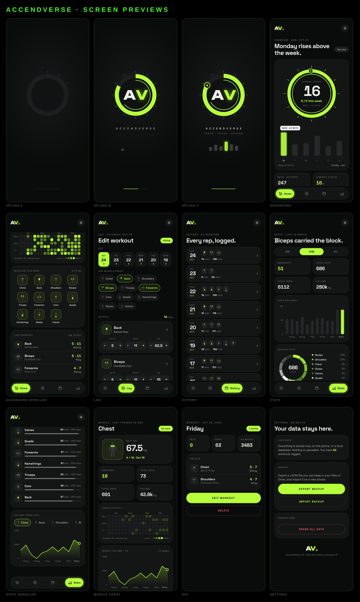
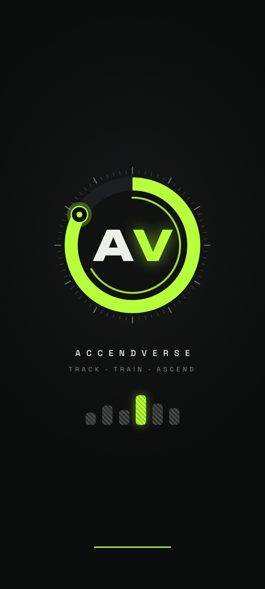
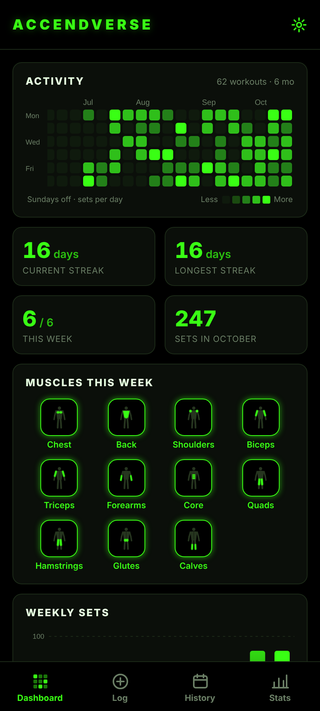
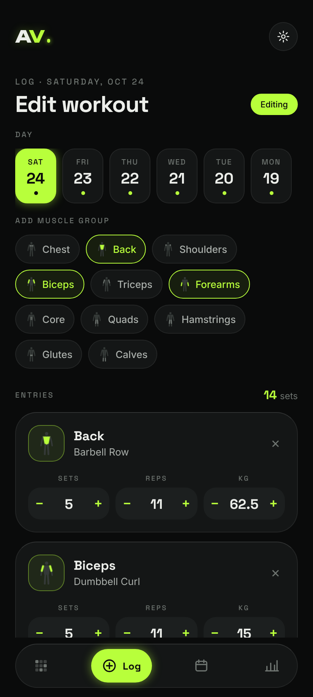
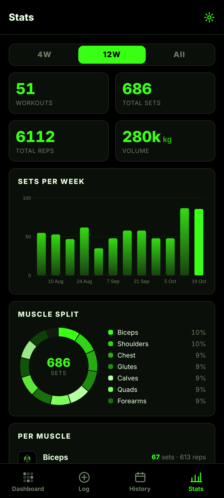
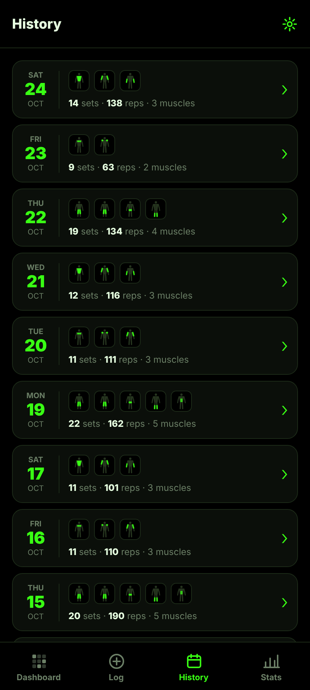
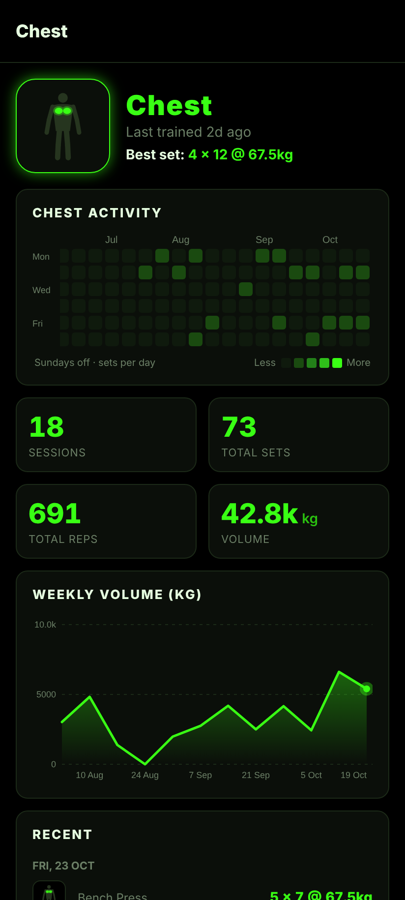
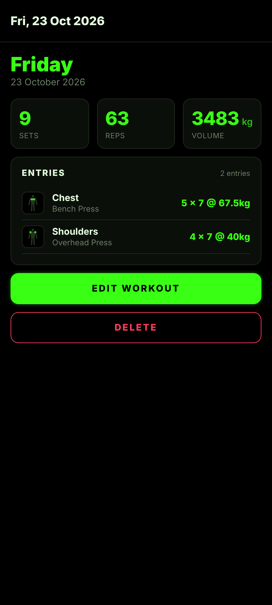
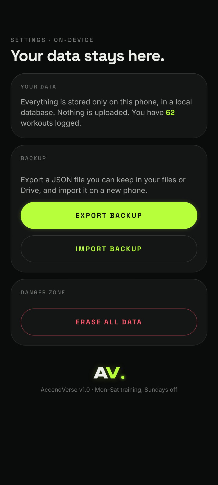

<div align="center">

# AV · AccendVerse

**Track. Train. Ascend.**

An offline gym progress tracker for Android, with a LeetCode-style activity grid, per-muscle logging, and a graphite and lime interface animated with [anime.js](https://animejs.com).




</div>

---

## Why AccendVerse

Most gym apps want an account, a subscription, and your data in their cloud. AccendVerse doesn't. You log what you did after a session, and it shows your consistency and progress. Everything stays on your phone.

## Features

### 🟩 Activity grid (LeetCode style)
- A 26-week heatmap with **Monday to Saturday rows only**. Sundays are rest days, so they never appear.
- A cell gets brighter the more **total sets** you did that day (5 levels, graphite to lime).
- Tap any cell to open that day's workout.
- Every muscle has its own grid on its detail page.

### 🔥 Streaks that respect rest days
- The **current** and **longest** streaks count only training days. A Sunday never breaks a streak and never adds to one.
- If you haven't logged today yet, your streak still counts up to yesterday.

### 💪 Per-muscle tracking
- 11 muscle groups: Chest, Back, Shoulders, Biceps, Triceps, Forearms, Core, Quads, Hamstrings, Glutes, Calves.
- Each entry stores **sets × reps**, plus an optional exercise name and weight in kg.
- Each muscle has a **custom SVG icon** (a body silhouette with that muscle lit). It appears next to every number.

### 📊 Dashboard and stats
- **Streak gauge**: a dial with a tick ring and a lime band for this week's progress (days trained out of 6), plus an inner arc for your current streak against your best.
- **This week**: striped Mon–Sat bars with a label on the top day.
- **Last 4 weeks**: ranked rows, with the best week highlighted.
- **Stats** for 4 weeks, 12 weeks or all time: totals, sets per week, a muscle split donut, per-muscle bars, and volume trends.
- **Needs work**: flags muscles you haven't trained in 7+ days.

### ✨ Motion
- **Loading screen**: an anime.js timeline. The tick ring sweeps on, the lime arc draws itself, **AV** drops in, and Mon–Sat bars rise. It runs in a WebView with anime.js and subset fonts built in, so it works with no internet.
- **In the app**: anime.js tweens drive count-up numbers, the heatmap filling in, growing chart bars, the gauge sweep, and a pulsing Save button.

### 🔒 Local-first
- All data lives in an on-device **SQLite** database.
- **Export / import** a JSON backup from Settings, for example to move to a new phone.
- No accounts, no network calls, no analytics.

## Screens

| Loading | Dashboard | Log | Stats |
|:--:|:--:|:--:|:--:|
|  |  |  |  |

| History | Muscle | Day | Settings |
|:--:|:--:|:--:|:--:|
|  |  |  |  |

## Install

1. Open the [**Actions**](../../actions/workflows/android.yml) tab and select the latest green **Android APK** run.
2. Download the **`AccendVerse-apk`** artifact (a zip) and extract `app-release.apk`.
3. Copy it to your phone and open it. Allow *Install unknown apps* if Android asks.

## Tech stack

| Area | Choice |
|---|---|
| Framework | Expo SDK 58 · React Native 0.88 · TypeScript (strict) |
| Navigation | Expo Router (file-based), custom floating tab bar |
| Storage | `expo-sqlite` (Android) · in-memory demo store (web previews) |
| Graphics | `react-native-svg`: heatmap, gauge, charts, muscle icons |
| Animation | anime.js v4 (WebView intro + JS-object tweens in-app) |
| Fonts | Unbounded (AV mark) · Space Grotesk (display) · Inter (body) |
| Dates | `date-fns` (Monday-start weeks) |
| Backup | `expo-file-system` + `expo-sharing` |

## Project structure

```
src/
  app/                    Expo Router screens
    (tabs)/index.tsx      Dashboard
    (tabs)/log.tsx        Log / edit a workout
    (tabs)/history.tsx    All sessions
    (tabs)/stats.tsx      Charts and breakdowns
    muscle/[id].tsx       Per-muscle detail
    day/[date].tsx        Single workout
    settings.tsx          Backup, import, erase
  components/             Gauge, HatchBars, WeekList, Heatmap, Charts, MuscleIcon, TabBar, Logo…
  data/                   SQLite store, web demo store, types, muscles
  lib/                    calendar (Mon–Sat logic, streaks), stats
  anim/                   anime.js bridge for React Native + hooks
  splash/                 anime.js intro (HTML → generated TS module)
scripts/build-splash.mjs  Inlines anime.js + subset fonts into the intro
__tests__/                Jest tests for calendar and stats logic
```

### Data model

```sql
workouts(id, date TEXT UNIQUE 'YYYY-MM-DD', notes, created_at)
entries (id, workout_id → workouts ON DELETE CASCADE,
         muscle, exercise, sets, reps, weight_kg)
```

Derived metrics: **sets per day** (heatmap), **reps** = sets × reps, **volume** = sets × reps × kg.

### anime.js on React Native

anime.js targets the browser. On native it is loaded through [`src/anim/anime.native.ts`](src/anim/anime.native.ts), which stubs the few DOM globals anime.js checks when it loads. After that, the app animates plain JS objects and pushes the values into React state and SVG props. The intro screen runs the full anime.js build, including SVG line drawing and staggered grids, inside a WebView.

## Development

```bash
npm install            # also generates src/splash/splashHtml.ts
npm test               # streak / calendar / stats tests
npm run typecheck
npx expo start         # dev server (needs a development build for native modules)
npx expo start --web   # browser preview with ~4 months of demo data
```

Build the APK locally (needs the Android SDK and JDK 17):

```bash
npx expo prebuild --platform android
cd android && ./gradlew assembleRelease
# → android/app/build/outputs/apk/release/app-release.apk
```

CI (`.github/workflows/android.yml`) runs the typecheck, the tests and the release build on every push to `main`, then uploads the APK as an artifact.

---

<div align="center">
<sub>Built with ⚡ lime and late-night sets · Sundays off</sub>
</div>
